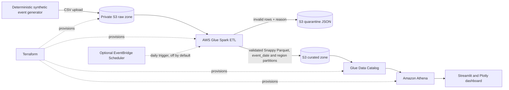

# Cloud Event Analytics Lakehouse

**A deployable, serverless AWS analytics pipeline for synthetic e-commerce clickstream data.** Generate events, land raw CSV in private Amazon S3, validate and transform it with AWS Glue into partitioned Parquet, query it with Amazon Athena, and explore revenue, conversion, regional performance, and product categories in a Streamlit + Plotly dashboard.

> This repository contains infrastructure and application code. It has not been deployed to an AWS account. Infrastructure deployment and Glue/Athena usage can incur charges; the recurring schedule is disabled by default.


## The problem it models

Clickstream event files are useful for product analytics but become expensive and hard to trust when they are unvalidated, stored as raw CSV, or queried without partition filters. This project demonstrates a repeatable path from raw synthetic events to quality-checked, compressed analytics data with auditable infrastructure and SQL.

## Architecture



## What is included

- Reproducible synthetic user-session journeys, with no real customer data or external dataset dependency.
- Glue ETL that casts and validates fields, removes duplicate event IDs, writes rejected rows with reasons to quarantine, enforces a configurable reject-rate threshold, and produces Snappy Parquet partitioned by date and AWS region.
- A deterministic full refresh from the raw S3 prefix. Re-running the job rebuilds the curated snapshot and removes duplicate event IDs across uploaded batches. This keeps the demo simple; large production lakes should use incremental processing or an ACID table format.
- Terraform for a private, versioned, encrypted S3 lake; an AWS Glue job and Data Catalog table; an Athena workgroup with an enforced encrypted query-results path; scoped Glue IAM permissions; and optional daily scheduling.
- Athena SQL for daily revenue, a session-level conversion funnel, regional average order value, and top product categories. Time-bounded queries include the date partition filter.
- A cached dashboard with query timeout, configurable 7–90 day window, revenue trend, conversion funnel, region and category charts.
- Docker packaging for the dashboard and GitHub Actions checks for Python style and Terraform formatting.

## AWS data layout

```text
s3://<lake-bucket>/
├── raw/events/events-<utc-timestamp>.csv
├── curated/events/event_date=YYYY-MM-DD/region=<aws-region>/*.parquet
├── quarantine/events/event_date=YYYY-MM-DD/region=<aws-region>/*.json
├── scripts/transform_events.py
├── temporary/                    # Glue temporary files
└── athena-results/               # query outputs; expires after 7 days
```

## Run locally: generate and inspect data

Requirements: Python 3.11+, Docker (optional for the dashboard), Terraform 1.6+, AWS CLI v2, and an AWS account/identity permitted to provision the resources in `infra/`.

```bash
python -m venv .venv
source .venv/bin/activate
python -m pip install -r requirements.txt
python data/generate_events.py --rows 10000 --seed 42
```

The sample is deterministic for the same row count and seed. The generator writes to `data/generated/events.csv`, which is ignored by Git.

## Deploy the AWS infrastructure

Configure AWS credentials locally using an AWS profile or another standard AWS credential provider. Do not commit credentials, `terraform.tfvars`, or state files.

```bash
cd infra
terraform init
terraform plan -out=tfplan
terraform apply tfplan
cd ..
```

Terraform creates resources only when you run `apply`. The daily EventBridge schedule defaults to disabled. To opt in, set `enable_daily_schedule = true` in a local `infra/terraform.tfvars`; scheduled Glue runs incur charges. The Glue job can also be started on demand as shown below.

## Upload, transform, and query

Read the bucket and job outputs, then upload a fresh synthetic batch and run the job:

```bash
BUCKET=$(terraform -chdir=infra output -raw bucket_name)
REGION=ap-south-1
python -m scripts.publish_sample --bucket "$BUCKET" --region "$REGION" --rows 10000
python -m scripts.run_pipeline \
  --region "$REGION" \
  --job-name "$(terraform -chdir=infra output -raw glue_job_name)" \
  --database "$(terraform -chdir=infra output -raw athena_database)" \
  --table "$(terraform -chdir=infra output -raw athena_table)"
```

The runner waits for Glue completion, reports failures, then executes `MSCK REPAIR TABLE` so Athena sees the new date/region partitions. Check Glue logs in CloudWatch if validation fails; rejected rows and their issue labels are written to the quarantine prefix.

## Launch the dashboard

Set these environment variables from the Terraform outputs before launching Streamlit:

```bash
export AWS_REGION=ap-south-1
export ATHENA_DATABASE="$(terraform -chdir=infra output -raw athena_database)"
export ATHENA_TABLE="$(terraform -chdir=infra output -raw athena_table)"
export ATHENA_WORKGROUP="$(terraform -chdir=infra output -raw athena_workgroup)"
export ATHENA_OUTPUT="$(terraform -chdir=infra output -raw athena_output_uri)"
streamlit run dashboard/app.py
```

Your local AWS identity needs permission to query Athena, read the Glue Catalog, and write/read objects in the Athena results prefix. The dashboard shows four analytics views and caches results for five minutes; use **Refresh Athena results** to clear the cache. To build the dashboard container, run `docker build -t cloud-event-analytics .` and `docker run --rm -p 8501:8501 --env-file .env cloud-event-analytics` after preparing a local `.env` with the values above and making AWS credentials available to the container.

## Data quality and analysis decisions

- Required identifiers, timestamp parsing, supported event types, nonnegative quantity, and nonnegative price are checked before curation.
- Missing, malformed, or unsupported records are retained in quarantine with a `quality_issue` reason.
- The Glue job fails after writing the audit outputs if the rejected-row rate is above `MAX_REJECT_RATE` (default 5%) or if no valid events remain.
- Event IDs are deduplicated across the raw prefix on each full-refresh run. Missing event IDs remain visible in quarantine instead of collapsing into one row.
- Session funnel counts represent sessions that reached each event stage within the selected date window; each session counts once per stage.
- Data is partitioned by `event_date` and `region`. Athena can scan fewer objects when queries include the date partition key; avoid unfiltered queries and `SELECT *` on larger data.
- This is a synthetic portfolio dataset, not a production customer analytics or identity-resolution system.

## Cost, security, and cleanup

- `terraform plan` is review-only; `terraform apply` creates AWS resources. S3 storage/requests, Glue job runs, Athena scanned bytes, and optional scheduled runs can incur charges. Keep the default schedule disabled and use the small synthetic dataset while learning.
- The Terraform bucket blocks all public access, enforces bucket-owner object ownership, enables versioning and server-side encryption, and expires Athena query results after seven days.
- The Glue job role can access only this project's raw, script, temporary, curated, and quarantine prefixes. The local dashboard uses your AWS identity and never embeds credentials.
- Athena charges by data scanned. Keep the dashboard date range bounded, use partition filters in new queries, and review the Athena workgroup metrics.
- To remove the demo after use, empty its S3 bucket (this permanently deletes its objects and versions), then run `terraform -chdir=infra destroy`. Review the bucket name and contents carefully before deleting anything.

## Useful AWS references

- [AWS Glue versions and runtimes](https://docs.aws.amazon.com/glue/latest/dg/release-notes.html)
- [AWS Glue crawlers and Data Catalog](https://docs.aws.amazon.com/glue/latest/dg/add-crawler.html)
- [Athena partitioning](https://docs.aws.amazon.com/athena/latest/ug/ctas-partitioning-and-bucketing-what-is-partitioning.html)
- [Athena table optimization](https://docs.aws.amazon.com/athena/latest/ug/performance-tuning-s3-throttling-optimizing-your-tables.html)

## License

MIT. See [LICENSE](LICENSE).
